# Catalogue de direction artistique

> Session 6, 2026-11-27. Propositions seulement : l'utilisateur trie (D-07, D-11).
> Toutes les images montrent la **même scène type** : plateau 6 × 8 en cases carrées vues de dessus (A1 à F8), ville d'Ostrelle en C3, Lancier choisi en D4, Archère en B2, Pillard ennemi en E5, cases atteignables marquées, attaque possible marquée, barre du haut (tour, or, savoir, menu), bouton « Fin du tour ».
> Noms d'unités, de ville et de clans : provisoires, inventés pour l'aperçu.

## Tableau résumé

| N° | Titre | L'idée en une ligne | Intérêt | Coût |
|---|---|---|---|---|
| DA-001 | Style Carnet d'explorateur | Carte dessinée à l'encre sur papier, terrains au lavis | Caractère fort, calme, original | L |
| DA-002 | Style Pixel 16 | Gros pixels, chaque case est un dessin 16 × 16 | Très léger, faisable seul, très lisible | S |
| DA-003 | Style Papier découpé | Formes de papier coloré superposées, ombres douces | Joyeux, lisible, tout en code | M |
| DA-004 | Style Plateau de bois | Tuiles peintes et pions en bois de jeu de société | Chaleureux, rappelle le plateau physique | M |
| DA-005 | Style Table tactique | Lignes lumineuses sur fond noir, motifs plutôt que couleurs | Tout en code, sobre, nuit | S |
| DA-006 | Palette Jour franc | Couleurs vives et nettes, fond clair | La plus sûre pour les daltoniens | S |
| DA-007 | Palette Nuit | Fond sombre, couleurs de clans claires | Jeu du soir, batterie OLED | S |
| DA-008 | Palette Lavis | Tons de papier, clans à l'encre franche | Va avec DA-001 ; terrains peu distincts | S |
| DA-009 | Palette Plein soleil | Contraste maximal, noir et jaune | Dehors, vue fatiguée | S |
| DA-010 | Interface Pouce | Tout dans le tiers bas, panneau qui glisse | Une main, repères simples | M |
| DA-011 | Interface Anneau | Actions en anneau autour de ce qu'on touche | Plateau en plein écran | L |
| DA-012 | Interface Onglets | Barre d'onglets : Carte, Villes, Savoir, Clans | Familière sur Android, rangée | M |

Coût : S = quelques jours, M = une à deux semaines, L = plus, ou demande des images faites ailleurs.

## Règles communes à toutes les propositions

- **Pas l'allure de Polytopia ni d'un autre jeu** (D-03) : aucune vue isométrique, aucun relief à facettes « low poly », aucun losange. Plateau vu de dessus, cases carrées, chaque style a son propre trait.
- **Jamais la couleur seule** pour dire à qui est une unité : nos pions sont ronds, ceux de l'ennemi en losange (en pixel : carré plein ou creux sous l'unité). Chaque terrain a aussi son symbole (vagues, arbres, sommets, points, herbes, hachures).
- **Cases de 54 px** (48 en pixel) sur un écran de 360 px de large : au-dessus des 48 dp recommandés pour une cible tactile.
- **Contrastes mesurés** (formule WCAG) pour le bouton « Fin du tour » de chaque style : Carnet 7,3:1, Pixel 10,3:1, Papier 5,0:1, Bois 6,5:1, Tactique 9,7:1. Tous au-dessus de 4,5:1.
- **Polices** : toutes sous licence SIL OFL 1.1 (libres, utilisables dans un jeu vendu), sous-ensemble latin avec les accents, 20 à 40 Ko chacune.

---

## DA-001 Style Carnet d'explorateur

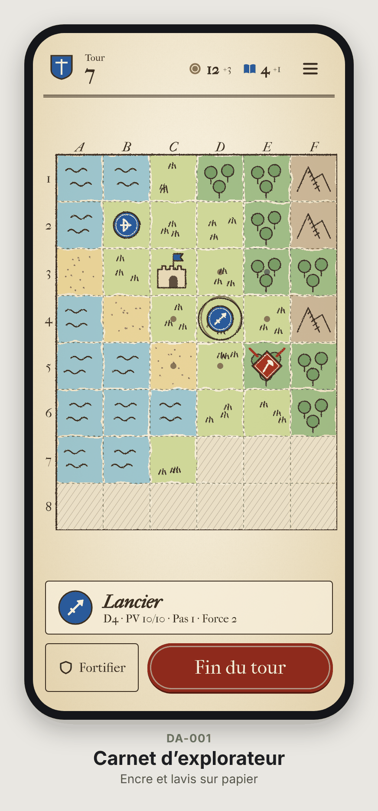

- **Intention** : la carte comme le carnet d'un voyageur. Traits d'encre un peu tremblés, terrains posés au lavis, brouillard en hachures, ville en petit fortin, unités en cachets de cire. Police IM Fell French Canon, gravée.
- **Lisibilité** : fond clair, symboles très différents d'un terrain à l'autre. Point faible : les chiffres de cette police sont « à l'ancienne » (le 1 ressemble à un I). Il faudrait une seconde police pour les nombres.
- **Coût sans dessinateur** : le trait tremblé et le lavis se font par le code (bruit et déformation), mais c'est lent à calculer sur un téléphone. Il faut donc pré-rendre les textures. C'est le style le plus exigeant pour avoir l'air soigné. Des images générées pourraient aider pour les textures de papier. Leur licence dépend de l'outil et de ses conditions, à vérifier avant usage.
- **Poids** : 0,5 à 2 Mo (textures de papier pré-rendues), police 30 Ko.
- **Dépendances** : va avec la palette DA-008 Lavis.

## DA-002 Style Pixel 16

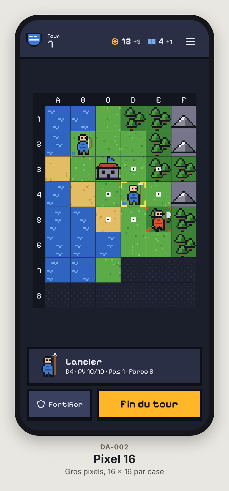

- **Intention** : gros pixels francs. Chaque case est un dessin de 16 × 16 pixels grossi 3 fois, les unités sont de petits personnages. Police Pixelify Sans.
- **Lisibilité** : excellente à petite taille, formes simples, fort contraste. Les personnages se reconnaissent à leur arme.
- **Coût sans dessinateur** : le plus faible. Les dessins tiennent dans des grilles de caractères (c'est ainsi qu'ils sont faits ici) ou dans un petit éditeur de pixels. La banque Kenney (CC0) a des tuiles pixel utilisables pour démarrer, mais leur allure est très connue : à remplacer ensuite.
- **Poids** : moins de 50 Ko pour toutes les images, police 15 Ko.
- **Risque** : le pixel art est très répandu, l'originalité doit venir des personnages et des couleurs.

## DA-003 Style Papier découpé

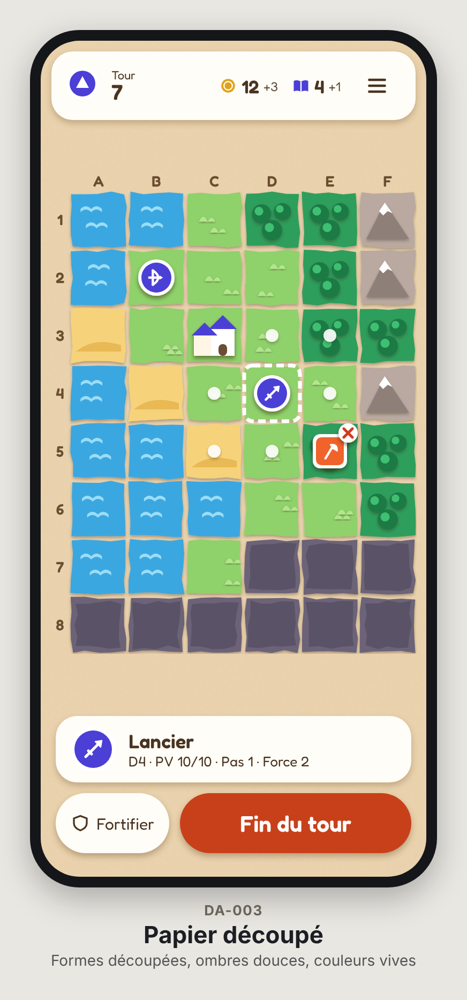

- **Intention** : un monde en papier coloré découpé aux ciseaux. Bords légèrement irréguliers, ombres douces, couleurs vives, pions en gommettes. Police Fredoka, ronde.
- **Lisibilité** : très bonne. Les aplats de couleur sont nets, les ombres détachent les pions du terrain.
- **Coût sans dessinateur** : tout se dessine par le code (formes simples, ombres). Le bord irrégulier se calcule à partir de la graine de la partie, donc chaque case est unique sans aucune image.
- **Poids** : moins de 300 Ko, police 25 Ko. Les ombres coûtent un peu au processeur graphique : on peut les cuire une fois par partie.
- **Ma recommandation** pour le jeu : original, gai, lisible, faisable seul.

## DA-004 Style Plateau de bois

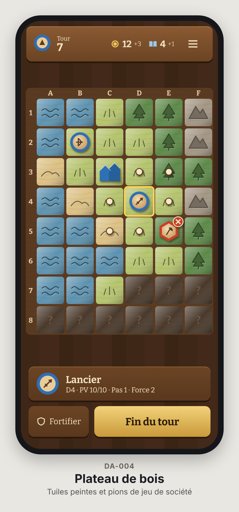

- **Intention** : un jeu de société posé sur une table. Tuiles peintes avec un biseau, pions en bois cerclés de la couleur du clan, ville en petites maisons de bois. Police Bitter.
- **Lisibilité** : bonne. Les tuiles séparées par un joint rendent la grille évidente. Les cases cachées portent un « ? ».
- **Coût sans dessinateur** : moyen. Dégradés et veinage se font par le code. Pour un bois réaliste, il faut une texture photo libre (CC0) ou générée.
- **Poids** : 200 à 500 Ko (textures de bois), police 30 Ko.

## DA-005 Style Table tactique

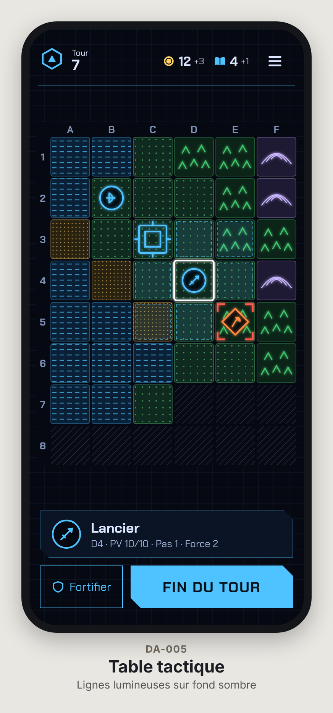

- **Intention** : un écran de commandement. Fond noir, terrains reconnus à leur motif (pointillés, tirets, courbes de niveau), lueur douce. Police Chakra Petch.
- **Lisibilité** : bonne de nuit. Les terrains se distinguent par le motif plus que par la couleur : c'est le style le plus sûr pour les daltoniens. Moins chaleureux, et la lueur fatigue un peu les yeux en plein jour.
- **Coût sans dessinateur** : faible, tout est lignes et motifs.
- **Poids** : moins de 100 Ko. Écran noir : économe sur un écran OLED.
- **Risque** : l'allure « science-fiction » est fréquente, l'univers du jeu doit la justifier.

---

## Palettes

Chaque fiche montre les six terrains, les six couleurs de clans et l'interface, simulés pour trois daltonismes (protanopie, deutéranopie, tritanopie ; modèle de Machado 2009 à sévérité maximale). L'« écart mini » est la plus petite distance entre deux couleurs du jeu (espace OKLab). Repères maison : 0,12 et plus = net, 0,07 à 0,12 = correct, moins de 0,07 = faible. Ce ne sont pas des seuils normalisés : un test avec de vraies personnes daltoniennes reste à faire.

| N° | Clans : écart mini (normal / protan / deutan / tritan) | Terrains : écart mini | Texte bouton | Texte secondaire |
|---|---|---|---|---|
| DA-006 Jour franc | 0,20 / 0,14 / 0,20 / 0,20 | 0,16 / 0,11 / 0,13 / 0,14 | 6,1:1 | 6,2:1 |
| DA-007 Nuit | 0,14 / 0,12 / 0,15 / 0,09 | 0,13 / 0,10 / 0,09 / 0,07 | 10,0:1 | 8,6:1 |
| DA-008 Lavis | 0,19 / 0,15 / 0,19 / 0,19 | 0,04 / 0,04 / 0,04 / 0,04 | 7,8:1 | 6,1:1 |
| DA-009 Plein soleil | 0,21 / 0,12 / 0,19 / 0,11 | 0,16 / 0,11 / 0,11 / 0,13 | 16,6:1 | 14,2:1 |

Tous les textes de l'interface passent le niveau AA (4,5:1) dans les quatre palettes.

### DA-006 Palette Jour franc
Couleurs vives sur fond crème. Clans : or, indigo, rouge, ciel, neige, charbon. C'est la plus robuste pour les daltoniens, à la fois pour les clans et pour les terrains. **Recommandée comme palette principale.** Coût : S, poids nul.

### DA-007 Palette Nuit
Fond presque noir, terrains sombres, clans clairs : soleil, lavande, braise, glace, lune, grenat. Pensée comme mode nuit de DA-006. Point faible : plaine et montagne se rapprochent en tritanopie (0,07), leurs symboles les séparent. Coût : S.

### DA-008 Palette Lavis
Terrains très pâles, comme de l'aquarelle ; clans à l'encre (outremer, ocre, vermillon, azur, encre, vélin). Les clans sont très nets. Les terrains, eux, se confondent (0,04) : ce sont les symboles qui portent l'information. Elle ne convient qu'avec un style à symboles forts (DA-001). Coût : S.

### DA-009 Palette Plein soleil
Noir, blanc, jaune et couleurs saturées, traits épais. Pour jouer dehors ou avec une vue fatiguée. Elle peut devenir un réglage « contraste élevé » plutôt que la palette de base. Coût : S.

---

## Interfaces

Dessinées avec la palette DA-006 et un style plat neutre, pour juger la disposition seule. Chaque image montre deux écrans : le Lancier choisi, puis une ville ou un autre écran.

### DA-010 Interface Pouce
- **Disposition** : barre du haut réduite (tour, or, savoir, menu). En bas, un panneau avec l'unité choisie, trois boutons (icône et mot) et « Fin du tour » sur toute la largeur. Toucher la ville fait monter le panneau avec la liste de production et les prix ; un bouton grisé signale ce qui est trop cher.
- **Lisibilité au téléphone** : tout ce qu'on touche souvent est dans le tiers bas, à portée du pouce. Cibles de 44 à 60 px, au moins 8 px d'écart. Police Nunito.
- **Coût** : M, ce sont des composants classiques.
- **Ma recommandation** : la plus simple à apprendre et à coder.

### DA-011 Interface Anneau
- **Disposition** : le plateau occupe tout l'écran, les informations flottent dans des pastilles. Toucher une unité ouvre ses actions en anneau autour d'elle ; toucher la ville ouvre trois choix de production avec leur prix et une croix au centre. « Fin du tour » est un gros bouton rond en bas à droite. Police Fredoka.
- **Lisibilité au téléphone** : on voit le maximum de carte. Le doigt peut cacher l'anneau, l'anneau doit se replier près des bords, et plus de quatre choix n'y tiennent pas.
- **Coût** : L (placement de l'anneau, cas des bords, gestes).

### DA-012 Interface Onglets
- **Disposition** : barre d'onglets Material en bas (Carte, Villes, Savoir, Clans). Au-dessus, sur la carte, un bandeau avec l'unité choisie et « Fin du tour ». L'onglet Savoir est une simple liste, avec l'état écrit en clair (acquis, fermé). Police Atkinson Hyperlegible, pensée pour les vues faibles.
- **Lisibilité au téléphone** : familière sur Android, chaque écran a une seule tâche. En contrepartie, il y a plus d'allers-retours pendant un tour.
- **Coût** : M.

Les modèles se combinent : par exemple DA-010 pour le tour, et les onglets de DA-012 cachés derrière le menu pour les écrans de gestion.

## Ce qui reste à vérifier sur le téléphone

Taille réelle des cases et des symboles en main, lisibilité en plein soleil (DA-009), confort du pouce (DA-010 et DA-011), fluidité des ombres et lueurs (DA-003, DA-005), lecture par des personnes daltoniennes.

---

# Deuxième série (mission 2, 2026-11-27)

> Après le tri (D-27) : papier découpé, palettes Jour franc et Nuit, interface Pouce. Plateau en perspective, en cases losange, sans adresse visible (D-16), départ zoomé (D-20). Clans de `clans.md` (branche `s2-game-design`). Noms d'unités et de villes provisoires.
> Toutes les images sont dessinées par le code (`source/iso.js`, `source/apercu2.html`), sans image extérieure.

| N° | Titre | L'idée en une ligne | Intérêt | Coût |
|---|---|---|---|---|
| DA-013 | Terrains en perspective | Trois façons de poser le papier : carton en couches, livre animé, collage à plat | Fixe le rendu de tout le plateau | M |
| DA-014 | Villages et villes | Village libre, ville de niveau 1 à 4, en maisons ou en gradins | Taille de ville lisible d'un coup d'œil | S |
| DA-015 | Unités des quatre clans | Personnages découpés debout : socle, coiffe et emblème propres à chaque clan | Reconnaissables même en gris | M |
| DA-016 | Brouillard qui se souvient | Jamais vu, déjà vu, en vue : papier vierge, calque, ou encre | Montre ce qu'on sait sans le cacher | S |
| DA-017 | Unité choisie et annonce du combat | Cases atteignables et résultat du combat montré avant d'attaquer | Combat sans surprise (D-23) | M |
| DA-018 | Écran Pouce de jour et de nuit | L'écran de jeu complet avec les choix recommandés | Vue d'ensemble avant le dessin | S |

## Points communs

- **Loin de Polytopia (D-03)** : les losanges sont communs, alors l'originalité vient du matériau. Ce sont des plaques de carton à tranche crème posées sur une table kraft, des personnages en papier à bord blanc, et des montagnes en couches de carton plutôt qu'en blocs à facettes. Les couleurs sont celles de « Jour franc », et l'interface reprend les cartes de papier blanc.
- **Taille** : au zoom de départ, une case mesure 72 × 36 px (environ deux fois la vue d'ensemble, D-20). En hauteur, c'est moins que les 48 dp conseillés pour une cible tactile. On touche donc la case entière et l'unité qui la dépasse. C'est à vérifier sur le téléphone.
- **Couleur jamais seule** : chaque clan a un socle (dents, carré, étoile, goutte), une coiffe et un emblème. L'unité choisie se soulève et sa case est cerclée de blanc ; l'ennemi attaquable est cerclé d'un rouge épais.
- **Poids** : tout se dessine par le code, sans image. Si on préfère pré-rendre les dessins, une feuille de dessins pour les 4 clans et 7 unités pèse moins de 300 Ko.

## DA-013 Terrains en perspective

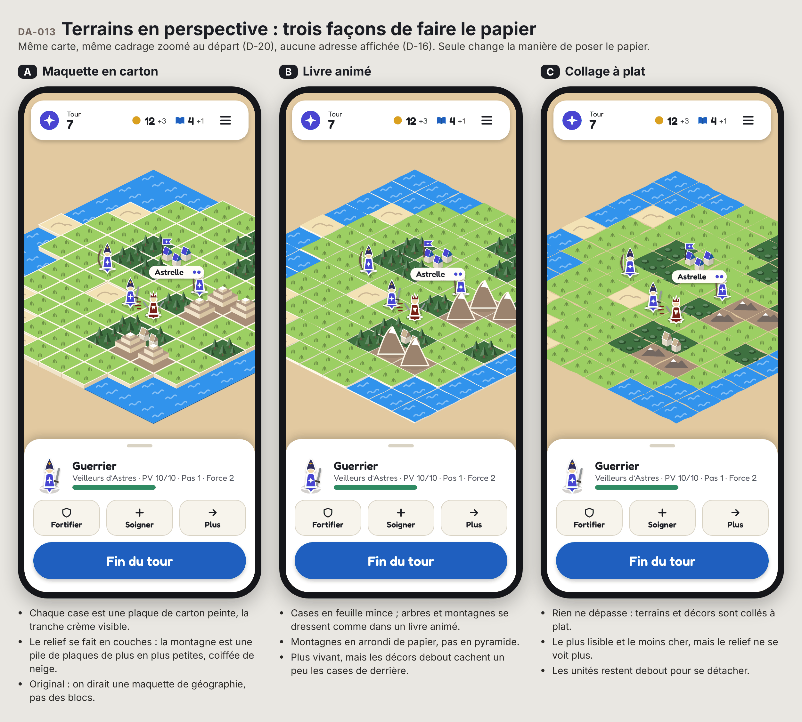

- **A Maquette en carton** (ma recommandation) : chaque case est une plaque de carton peinte, avec sa tranche visible. Le relief monte par couches, la montagne étant une pile de plaques de plus en plus petites. C'est le plus original, et le relief se lit bien. Coût M.
- **B Livre animé** : la case est une feuille mince, et arbres et montagnes se dressent comme dans un livre animé. C'est plus vivant, mais les décors cachent les cases situées derrière eux. Coût M.
- **C Collage à plat** : tout est collé à plat. C'est le plus lisible et le moins cher, mais le relief disparaît. Coût S.

## DA-014 Villages et villes

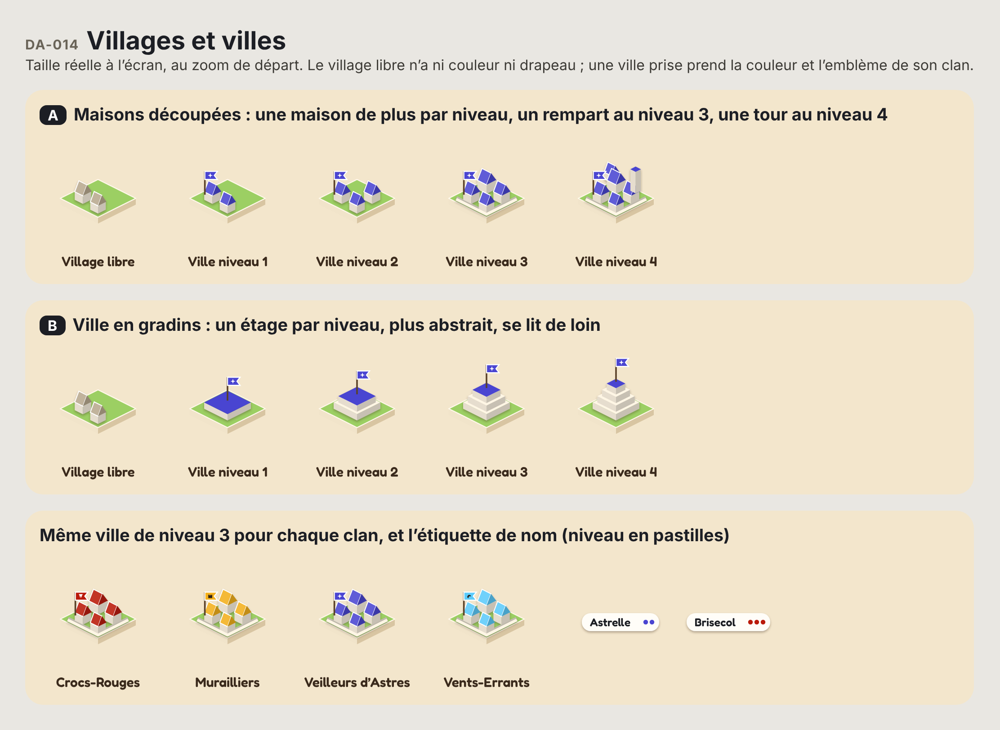

- **A Maisons découpées** (ma recommandation) : la ville gagne une maison par niveau, un rempart au niveau 3 et une tour au niveau 4. Le toit, le drapeau et l'emblème portent la couleur du clan.
- **B Ville en gradins** : un étage par niveau. C'est plus abstrait, se compte de loin, mais a moins de charme.
- Le village libre est gris-beige, sans drapeau. Sous chaque ville, une étiquette blanche donne son nom, et ses pastilles son niveau.

## DA-015 Unités des quatre clans

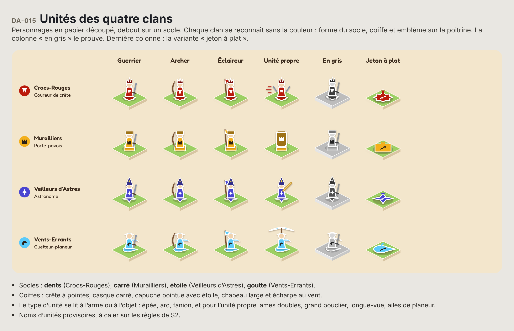

- **Personnages debout** (ma recommandation) : un personnage en papier sur un socle. Chaque clan a son socle, sa coiffe et son emblème sur la poitrine, et le type d'unité se lit à l'arme ou à l'objet. La colonne « en gris » montre que les clans se distinguent sans la couleur.
- **Jetons à plat** : le socle agrandi avec le symbole de l'unité. C'est plus sobre, mais on reconnaît moins bien le type d'unité.
- Unités propres : Coureur de crête (lames doubles), Porte-pavois (grand bouclier), Astronome (longue-vue), Guetteur-planeur (ailes).

## DA-016 Brouillard qui se souvient

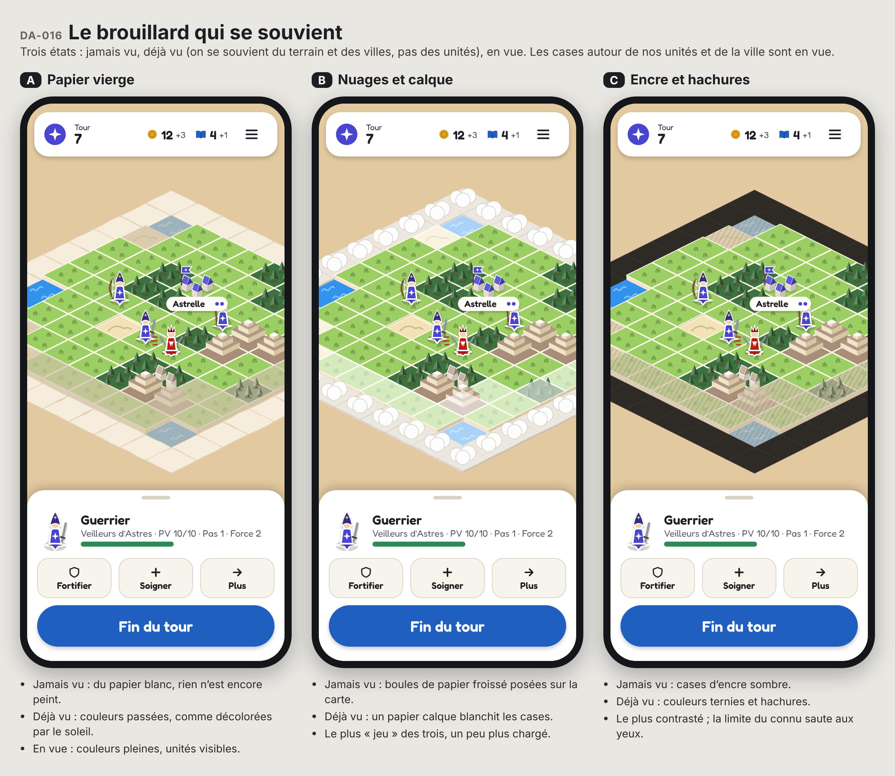

- **A Papier vierge** (ma recommandation) : ce qu'on n'a jamais vu est du papier blanc. Ce qu'on a déjà vu garde des couleurs passées, avec ses villes mais sans ses unités. C'est la plus douce et la plus cohérente avec le papier.
- **B Nuages et calque** : boules de papier froissé sur l'inconnu, papier calque sur ce qu'on a déjà vu.
- **C Encre et hachures** : encre sombre sur l'inconnu, hachures sur ce qu'on a déjà vu. C'est le plus contrasté.

## DA-017 Unité choisie et annonce du combat

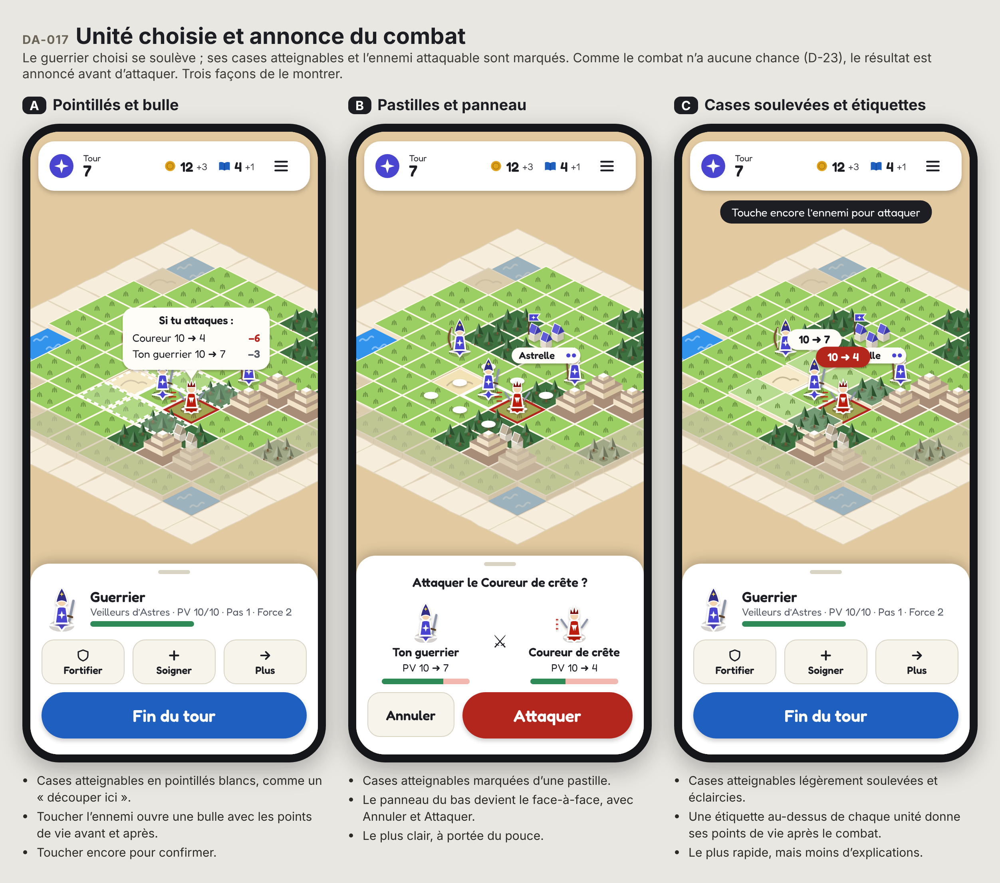

- **A Pointillés et bulle** : les cases atteignables sont en pointillés. Une bulle au-dessus de l'ennemi annonce les points de vie après le combat, et on touche encore pour confirmer.
- **B Pastilles et panneau** (ma recommandation) : les cases atteignables portent une pastille. Le panneau du bas devient un face-à-face avec les deux barres de vie et les boutons Annuler et Attaquer. Tout reste à portée du pouce, et le choix est explicite.
- **C Cases soulevées et étiquettes** : les cases atteignables sont soulevées. Une étiquette au-dessus de chaque unité donne ses points de vie après le combat. C'est le plus rapide, mais il explique le moins.

## DA-018 Écran Pouce de jour et de nuit

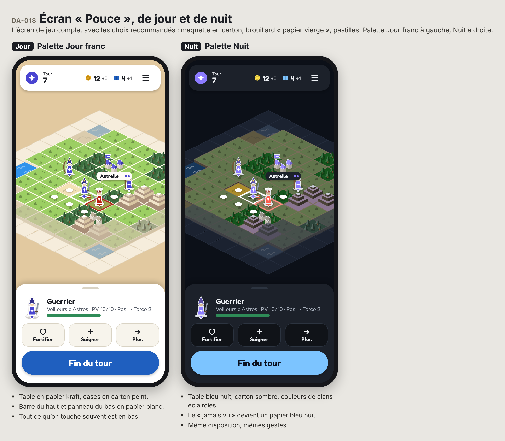

- Il assemble les choix recommandés : carton, maisons, personnages debout, papier vierge et pastilles. La version Nuit garde la même disposition sur une table bleu nuit.
- À vérifier sur le téléphone : taille des cases et des personnages en main, et lecture du « déjà vu » de nuit, qui reste sombre.
